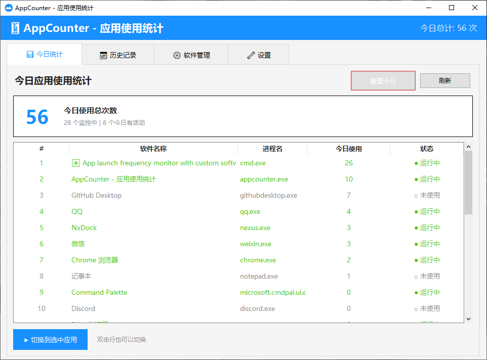

# AppCounter - 电脑软件使用次数监控工具

监控电脑打开微信、QQ 等常见软件的次数，支持自定义添加监控软件。

## 功能特点

- **实时监控**：自动检测目标软件的启动，记录每次打开
- **今日统计**：查看当天各软件使用次数，标注运行状态
- **历史记录**：按日期范围查询历史使用数据
- **软件管理**：预设 20+ 常见软件，支持自定义添加/删除/重命名
- **系统托盘**：最小化到托盘后台运行，不打扰日常工作
- **数据持久化**：数据存储在本地 JSON 文件，随时可查看或备份

## 软件截图



## 快速开始

### 方式一：直接运行 EXE（推荐）

双击 `AppCounter.exe` 即可启动，无需安装任何依赖。

### 方式二：Python 源码运行

- Windows 10 / 11 + Python 3.8+

```bash
pip install -r requirements.txt
python main.py
```

## 命令行参数

```
AppCounter.exe              # 正常 GUI 模式（双击运行）
AppCounter.exe --console    # 纯后台模式（无 GUI 窗口）
AppCounter.exe --reset      # 重置所有数据后退出
```

## 预设监控软件

| 软件 | 进程名 | 默认启用 |
|------|--------|----------|
| 微信 | wechat.exe | ✅ |
| QQ | qq.exe | ✅ |
| TIM | tim.exe | ✅ |
| 钉钉 | dingtalk.exe | ✅ |
| 飞书 | feishu.exe | ✅ |
| WPS Office | wps.exe | ✅ |
| Word | winword.exe | ✅ |
| Excel | excel.exe | ✅ |
| PowerPoint | powerpnt.exe | ✅ |
| Chrome 浏览器 | chrome.exe | ✅ |
| Edge 浏览器 | msedge.exe | ✅ |
| Firefox 浏览器 | firefox.exe | ✅ |
| 记事本 | notepad.exe | ✅ |
| 计算器 | calc.exe | ✅ |
| VS Code | vscode.exe | ✅ |
| Telegram | telegram.exe | ✅ |
| Discord | discord.exe | ✅ |
| Steam | steam.exe | ✅ |
| 文件资源管理器 | explorer.exe | ❌ (默认关闭) |
| VS Code Insiders | code.exe | ❌ (默认关闭) |

## 添加自定义软件

1. 打开要监控的软件
2. 按 `Ctrl+Shift+Esc` 打开任务管理器
3. 切换到「详细信息」标签页
4. 找到目标软件的进程名（如 `notepad.exe`）
5. 在 AppCounter 的「软件管理」页面点击「＋ 添加自定义软件」
6. 输入进程名和显示名称即可

## 开机自启

将 `AppCounter.exe --console` 的快捷方式放入启动文件夹即可：
1. `Win + R` 输入 `shell:startup` 回车
2. 创建 `AppCounter.exe --console` 的快捷方式

## 数据存储

所有数据存储在 `app_counter_data.json` 文件中，与程序同目录。
